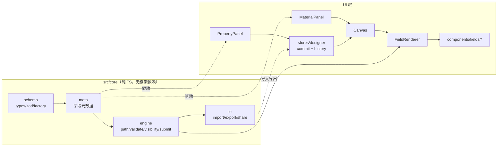

# Form Builder · 可视化表单设计器

Vue3 + TypeScript 的可视化表单/流程设计器。拖拽组装表单 → 导出 JSON Schema → 分享链接直接填写提交。Schema 引擎与框架解耦，为二期用 Next.js + React 重写同一套引擎做准备。

## 当前状态

| 阶段 | 内容 | 状态 |
|---|---|---|
| S0 | 脚手架（构建 / 规范 / 部署 / AI 协作配置） | ✅ 完成 |
| S1 | Schema 与递归渲染（W1） | 🚧 进行中 |
| S2 | 可视化设计器（W2） | ⬜ 未开始 |
| S3 | 上线与素材（W3） | ⬜ 未开始 |

进度细节见 [`docs/一期-任务清单.md`](docs/一期-任务清单.md)。

## 快速开始

```bash
pnpm install
pnpm dev          # http://localhost:5173
```

常用命令：

```bash
pnpm typecheck    # vue-tsc --noEmit
pnpm lint         # ESLint（含 src/core 框架无关检查）
pnpm test         # Vitest
pnpm build        # typecheck + 构建到 dist/
pnpm verify       # 上面四项全跑，任务收尾必过
```

## 架构



**关键约束**：`src/core` 不能 import Vue / Pinia / Element Plus，由 ESLint 强制。二期换 React 时该目录整块复用。

## 目录

```
src/core/          Schema 定义、校验、联动、路径寻址、导入导出、分享编码
src/components/    字段组件与递归渲染器
src/views/         Designer（设计器）/ Preview（填写页）
src/stores/        Pinia 状态（schema + 选中态 + 历史栈）
docs/              技术方案、任务清单
AGENTS.md          AI 编码约定（硬边界、执行流程、已知坑）
.opencode/commands AI 编码用的斜杠命令（/next-task、/review、/ship）
```

## 文档

- [技术方案（Schema 设计、决策理由、风险与降级）](docs/一期-技术方案.md)
- [任务清单（28 项，含验收标准）](docs/一期-任务清单.md)
- [core 层约束](src/core/README.md)

## 已知限制

本阶段为纯前端实现，刻意的取舍：

1. **提交数据只存本机 localStorage**，换设备看不到。`SubmitAdapter` 已抽象，接真后端时调用方零改动。
2. **upload 字段不做真上传**：只做文件选择 + 大小/类型前端校验 + 提交文件名列表。
3. **分享链接靠 URL 承载 Schema**，编码后超过 6000 字符会提示改用 JSON 导入。
4. **仅 hash 路由**：GitHub Pages 无服务端 rewrite，换 history 模式刷新即 404。

## 部署

推 `main` 自动部署到 GitHub Pages（workflow 会先跑 `pnpm verify`，不通过不部署）。

首次上线需手动完成：

1. 建仓库并 `git remote add origin <url>`，push `main`
2. 仓库 Settings → Pages → Source 选择 **GitHub Actions**

本地模拟子路径构建：

```bash
VITE_BASE=/form-builder/ pnpm build && pnpm preview
```
