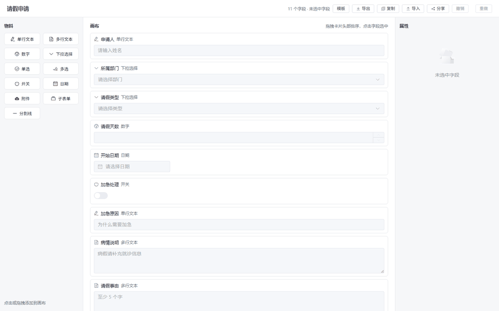
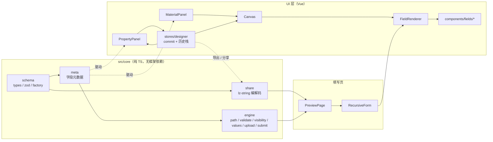

# Form Builder · 可视化表单设计器

Vue3 + TypeScript 的可视化表单设计器：拖拽组装表单 → 导出 JSON Schema → 分享链接直接填写提交。Schema 引擎与框架解耦，为二期用 React 重写同一套引擎做准备。

- 在线设计器：https://liuyapeng00.github.io/form-builder/
- 表单填写页：https://liuyapeng00.github.io/form-builder/#/f
- 仓库：https://github.com/LiuYapeng00/form-builder



## 能做什么

- **组装**：11 种字段（单行文本 / 多行文本 / 数字 / 下拉 / 单选 / 多选 / 开关 / 日期 / 附件 / 子表单 / 分割线），拖拽或点击物料添加
- **配置**：属性面板分「基础 / 选项 / 校验 / 联动」四个 tab，输入 300ms 防抖提交，不产生垃圾历史
- **嵌套**：子表单可拖入子字段、可排序，支持多行增删
- **撤销重做**：整树快照，最多 50 步，`Ctrl+Z` / `Ctrl+Shift+Z` / `Ctrl+Y`
- **流转**：导出 / 导入 JSON（zod 校验，报错定位到字段）、生成分享链接（lz-string 压缩进 URL）
- **填写**：递归渲染 + 联动显隐 + 校验 → 提交写入 localStorage → 成功结果页
- **开箱即用**：内置「请假申请」「员工信息登记」两套模板，含子表单与联动
- **移动端**：`≤768px` 全单列，无横向滚动

## 当前状态

| 阶段 | 内容                                       | 状态                           |
| ---- | ------------------------------------------ | ------------------------------ |
| S0   | 脚手架（构建 / 规范 / 部署 / AI 协作配置） | ✅ 完成                        |
| S1   | Schema 与递归渲染（W1）                    | ✅ 完成                        |
| S2   | 可视化设计器（W2）                         | ✅ 完成                        |
| S3   | 上线与素材（W3）                           | 🚧 进行中（README / 性能实测） |

进度细节见 [`docs/一期-任务清单.md`](docs/一期-任务清单.md)。

## 快速开始

环境：Node ≥ 22、pnpm 10。

```bash
pnpm install
pnpm dev          # http://localhost:5173
```

| 命令             | 用途                                   |
| ---------------- | -------------------------------------- |
| `pnpm dev`       | 本地开发                               |
| `pnpm typecheck` | `vue-tsc --noEmit`                     |
| `pnpm lint`      | ESLint（含 `src/core` 框架无关检查）   |
| `pnpm test`      | Vitest，只测 `tests/**`，主要覆盖 core |
| `pnpm build`     | typecheck + 产物构建到 `dist/`         |
| `pnpm verify`    | 以上四项全跑，任务收尾必过             |

## 架构



**关键约束**：`src/core` 不能 import Vue / Pinia / Element Plus / vue-router，由 ESLint 强制。二期换 React 时该目录整块复用，只重写 UI 层。

## Schema 说明

一份表单就是一个可序列化的 JSON，**校验规则与联动条件都是数据，不是函数**——这样才能导入导出、跨框架复用。

```jsonc
{
  "schemaVersion": 1,
  "id": "sample-leave-application",
  "name": "请假申请",
  "layout": { "type": "grid", "columns": 2 },
  "submit": { "text": "提交申请", "successMsg": "请假申请已提交" },
  "fields": [
    {
      "id": "f-name",
      "name": "applicant", // 提交数据的 key，同级唯一
      "type": "input",
      "label": "申请人",
      "props": { "placeholder": "请输入姓名" },
      "rules": [{ "type": "required" }],
    },
    {
      "id": "f-days",
      "name": "days",
      "type": "number",
      "label": "请假天数",
      "props": { "min": 0.5, "max": 30 },
      "rules": [
        { "type": "required" },
        { "type": "range", "min": 0.5, "max": 20, "message": "需在 0.5 ~ 20 天之间" },
      ],
    },
    {
      "id": "f-reason",
      "name": "urgentReason",
      "type": "textarea",
      "label": "加急原因",
      "props": {},
      "rules": [{ "type": "required" }],
      // 联动是结构不是表达式：依赖同级字段 urgent 的值
      "visibleWhen": { "field": "urgent", "op": "eq", "value": true },
    },
    {
      "id": "f-handover",
      "name": "handover",
      "type": "subform",
      "label": "交接事项",
      "props": { "columns": 1 },
      "rules": [],
      "children": [
        {
          "id": "f-handover-item",
          "name": "item",
          "type": "input",
          "label": "交接内容",
          "props": {},
          "rules": [{ "type": "required" }],
        },
      ],
    },
  ],
}
```

| 概念          | 约定                                                                                    |
| ------------- | --------------------------------------------------------------------------------------- |
| `Rule`        | `required` / `pattern` / `range` / `len`，编译成 async-validator 规则                   |
| `visibleWhen` | `eq` / `neq` / `in` / `empty` / `notEmpty`，隐藏字段提交前剔除                          |
| 值寻址        | 统一 `getByPath` / `setByPath`（如 `handover[0].item`），禁止手工拼字符串               |
| 子表单值      | 对象数组，行由 `createRowValue(children)` 初始化                                        |
| 提交结构      | `SubmitPayload { schemaId, schemaVersion, data, submittedAt }`，一期落 `fb:submissions` |

## 技术选型

| 选择                           | 理由                                                                                         |
| ------------------------------ | -------------------------------------------------------------------------------------------- |
| Vue 3 + TS（`<script setup>`） | 组合式 API 便于把 schema 逻辑收进 composable；TS 保证 Schema 类型在 core / UI / 测试三处一致 |
| Element Plus（按需引入）       | `el-form` 的校验、日期、下拉等组件成熟，省掉自研表单控件的成本                               |
| zod                            | 导入 JSON 是不可信输入，运行时校验 + `fields[0].name` 级错误定位                             |
| vue-draggable-plus             | Sortable 的 Vue 封装，支持分组与嵌套列表；统一 `forceFallback` 规避 HTML5 拖拽的兼容问题     |
| Pinia                          | 设计器状态集中；`commit(mutator)` 整树快照实现撤销重做，比 patch 增量简单可靠                |
| lz-string                      | 分享链接把 Schema 压进 URL，`compressToEncodedURIComponent` 对中文友好                       |
| hash 路由                      | GitHub Pages 无服务端 rewrite，history 模式刷新即 404                                        |
| Vitest                         | 与 Vite 共用配置，core 层纯函数测试启动快                                                    |

## 目录

```
src/core/          Schema 定义 / zod / 工厂、字段元数据、校验、联动、路径寻址、导入导出、分享编码
src/components/    字段组件（fields/*）与递归渲染器（renderer/*）
src/views/         Designer（设计器）/ Preview（填写页）
src/stores/        Pinia 状态（schema + 选中态 + 历史栈）
src/samples/       内置示例模板与注册表
tests/             Vitest 单测（core 为主）
docs/              技术方案、任务清单、演示素材
AGENTS.md          AI 编码约定（硬边界、执行流程、已知坑）
```

## 已知限制

本阶段为纯前端实现，以下是刻意的取舍：

1. **提交数据只存本机 localStorage**（`fb:submissions`），换设备看不到。`SubmitAdapter` 已抽象，接真后端时调用方零改动。
2. **upload 字段不做真上传**：只做文件选择 + 大小/类型/数量前端校验 + 提交文件名数组。
3. **分享链接靠 URL 承载 Schema**，编码后超过 6000 字符会明确提示改用 JSON 导入，不静默截断。
4. **仅 hash 路由**：GitHub Pages 无服务端 rewrite，换 history 模式刷新即 404。
5. **一期不含**：审批流编排、Schema 版本化 / 回滚、用户体系、权限、多租户、数据统计、模板市场。

## 性能

环境：Intel i9-14900HX / 16GB / Chrome 156 headless（1440×900），生产构建 `pnpm build` + `pnpm preview`。测量脚本 [`scripts/perf/measure.mjs`](scripts/perf/measure.mjs)，数字可复现。

| 指标                                    | 实测                                                         |
| --------------------------------------- | ------------------------------------------------------------ |
| 100 字段设计器首次渲染                  | **142 ms**（中位数，8 次采样 124–153 ms；11 字段基线 28 ms） |
| 100 字段下连续输入 30 次                | p95 帧 **8.1 ms**，最长 9.0 ms，0 个 >50 ms 长任务           |
| 100 字段下连续提交 8 次（每次整树快照） | p95 帧 8.1 ms，最长 8.6 ms，0 长任务                         |
| 100 字段下拖拽重排                      | p95 帧 **4.7 ms**，最长 8.4 ms，0 长任务                     |
| 设计器首屏 JS                           | **669 kB raw / 219 kB gzip**（实测传输 218.6 kB）            |
| 设计器首屏 CSS                          | 148 kB raw / 21 kB gzip（实测传输 22.0 kB）                  |
| 构建产物 `dist/`                        | **871 kB raw / 250 kB gzip**（9 个文件）                     |

结论：100 字段一次性渲染约 0.14s；交互期间每帧 p95 ≤ 8.1ms，仍在 60fps 的 16.7ms 预算内，**100 字段可正常编辑**，不需要虚拟滚动。体积主要来自 Element Plus，二期若要压首屏优先做细粒度分包。

复现：

```bash
pnpm build
pnpm preview --port 4173   # 另开终端
node scripts/perf/measure.mjs
```

脚本自动拉起 headless Chrome，输出渲染耗时、帧耗时、长任务与首屏传输体积；`PERF_ROUNDS` / `PERF_BASE` 可覆盖采样轮数与地址。

## 部署

推 `main` 自动部署到 GitHub Pages（workflow 先跑 `pnpm verify`，不通过不部署）。

首次上线需手动完成：

1. 建仓库并 `git remote add origin <url>`，push `main`
2. 仓库 Settings → Pages → Source 选择 **GitHub Actions**

本地模拟子路径构建：

```bash
VITE_BASE=/form-builder/ pnpm build && pnpm preview
```

## 文档

- [技术方案（Schema 设计、决策理由、风险与降级）](docs/一期-技术方案.md)
- [任务清单（28 项，含验收标准）](docs/一期-任务清单.md)
- [core 层约束](src/core/README.md)
